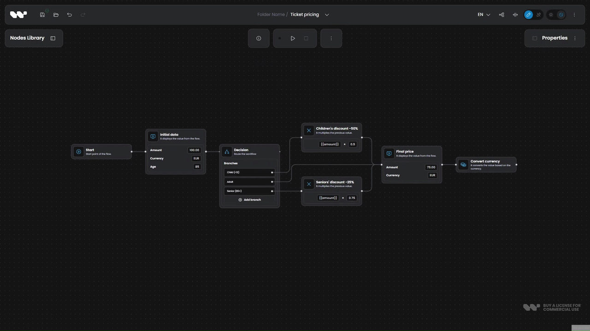
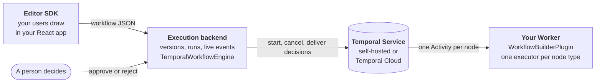

<div align="center">

<a href="https://www.workflowbuilder.io/"></a>

# Open-source framework for workflow orchestration in your product

### Your users draw the workflow. Temporal runs it. You see every step.

Workflow Builder ships the full stack: a white-label React workflow builder for your users, durable execution on your own [Temporal](https://temporal.io), human approval steps for AI agents and business processes, and a live view of every run.

[](https://github.com/synergycodes/workflowbuilder/actions/workflows/build.yml)
[](./LICENSE)
[](https://www.npmjs.com/package/@workflowbuilder/sdk)
[](https://discord.com/invite/FDMjRuarFb)



**[▶ Run a workflow in your browser](https://aistudio.workflowbuilder.io/)** · no install, no sign-up

[Embed the editor](#path-a-embed-the-sdk) · [Orchestrate on your Temporal](#path-d-add-workflow-orchestration-on-your-temporal) · [Run the full stack](#path-c-run-the-full-stack-demo) · [Documentation](https://www.workflowbuilder.io/docs/overview/)

</div>

## Drawing boxes and arrows is the easy part

Your customers want to automate their work inside your product, not in another tool. With React Flow and an AI assistant, a demo canvas takes a weekend. The time goes into everything around it:

- **An editor people can work in all day:** forms generated from your schemas, validation, your node types, your design system.
- **Durability:** a run picks up where it left off after a crash or a worker restart, retries the flaky step and fails fast on the broken one.
- **Human-in-the-loop:** a step waits for a person to approve, correct or reject, for minutes or for weeks, with nothing polling in the meantime.
- **Versions:** your customers run the published version while they edit the next one, and every run is pinned to the graph it started with.
- **A live view of every run:** what ran, what it returned, where it waits, why it failed.

Workflow Builder ships all of it, the editor and the workflow orchestration on Temporal behind it, as one open-source stack on your infrastructure. Use the whole stack, or only the parts you need.

## What you get

**Build.** A complete workflow editor in your React app: palette, canvas and a properties panel generated from JSON Schema, with validation. Your node types, your design tokens and logo, light and dark themes, plugins. Workflows are saved as JSON to your API, a callback or `localStorage`. [Vercom](https://www.workflowbuilder.io/case-study/vercom), [Athena Intelligence](https://www.workflowbuilder.io/case-study/athena-intelligence) and [Plura AI](https://www.workflowbuilder.io/case-study/plura-ai) built their workflow editors on it.

**Orchestrate.** Durable workflow orchestration on your own Temporal, self-hosted or [Temporal Cloud](https://temporal.io/cloud): the diagrams your users draw run as durable workflows. One generic workflow runs any diagram with one start node and no loops, so a new or changed process ships without new workflow code, as long as it uses node types your Workers already run. Independent branches run in parallel and join, a decision routes the run down one branch, each node type can get its own timeout and retry cap, and an error that cannot succeed on retry fails fast instead of burning attempts.

**Decide.** Pause any step for a person. The run waits in Temporal, for minutes or for weeks, holding no Worker and running no code, until someone approves, approves with corrections, or rejects with a reason. The first decision wins, a late one is refused with an answer, and the decision, corrections included, is recorded with the run for the next steps to read.

**Observe.** Watch a run live on the canvas: each step is marked running, completed, failed, skipped or waiting, and the log shows what every step returned and why one failed. Every run keeps the exact graph it ran and its ordered event history, streamed to the browser as it happens. In Temporal Web UI each step shows up under your node's name. AI Studio has this run view built in, as open code you can carry into your own app.

**Own.** Apache 2.0, the whole stack in this repository: embed it, white-label it, ship it to your customers. It runs on your Temporal and your Postgres, with any OpenAI-compatible model, including one inside your network. No per-run pricing from us, and open code you can fork.

## How it fits together

**Editor SDK · Temporal Plugin · Execution backend: open code, yours to own.**



| Block                 | What it does                                                                                                                                                                                                                                                                                                                                                              | Where it lives                                                                                                                                                |
| --------------------- | ------------------------------------------------------------------------------------------------------------------------------------------------------------------------------------------------------------------------------------------------------------------------------------------------------------------------------------------------------------------------- | ------------------------------------------------------------------------------------------------------------------------------------------------------------- |
| **Editor SDK**        | The visual workflow builder your users work in. Built on [React Flow](https://reactflow.dev). Outputs workflow JSON.                                                                                                                                                                                                                                                      | npm: [`@workflowbuilder/sdk`](https://www.npmjs.com/package/@workflowbuilder/sdk), [`@workflowbuilder/ui`](https://www.npmjs.com/package/@workflowbuilder/ui) |
| **Temporal Plugin**   | The workflow orchestration layer, built on Temporal's Plugin API (`SimplePlugin` from `@temporalio/plugin`) and added with `Worker.create({ plugins: [plugin] })`. Runs a diagram as one Temporal Workflow Execution, one Activity per node: parallel branches, routing, per-node error policies, retries and timeouts per node type, durable pauses for human decisions. | npm: [`@workflowbuilder/temporal`](https://www.npmjs.com/package/@workflowbuilder/temporal)                                                                   |
| **Execution backend** | HTTP API around the engine: drafts and published versions, starting, cancelling and listing runs, a snapshot of each run's graph, live run events over SSE, human decisions, ports for your auth and tenancy.                                                                                                                                                             | this repo: [`apps/backend`](./apps/backend/README.md), with the Temporal Worker in [`apps/execution-worker`](./apps/execution-worker/README.md)               |
| **AI Studio**         | The whole stack as one app: AI workflow templates, a live run view on the canvas and the decision panel. The [hosted demo](https://aistudio.workflowbuilder.io/) is this app.                                                                                                                                                                                             | this repo: [`apps/ai-studio`](./apps/ai-studio/README.md)                                                                                                     |

**Your code plugs in, the framework calls it.** You write one executor function per node type, which can call your APIs, an LLM or an agent framework. Every node is your code, so there is no low-code ceiling: your users compose the flow, your executors do the work. A store port decides where run events land. `AuthPort` and `TenantContextPort` connect your identity provider and tenant model.

## Why not just…

**…build it on React Flow?** You will have a canvas quickly. Then come the properties forms, validation, theming, versions, a worker that executes the graph, retries and backoff, human steps and run history. Workflow Builder is built on React Flow and ships the rest.

**…embed n8n or another automation tool?** As of October 2026, n8n's [license FAQ](https://docs.n8n.io/n8n-community-license/community-license/license-faq) rules out letting external users build workflows through your product, and its paid [OEM offer](https://n8n.io/oem/) is priced per execution and keeps n8n branding in the editor. Workflow Builder is Apache 2.0, white-label included: it renders as React components inside your app, with no iframe, runs your node types and lives on your infrastructure.

**…use Temporal alone?** Temporal runs workflows your developers write in code, and its Web UI is made for debugging. Workflow Builder adds visual workflow orchestration on top: your users draw the workflow, one generic workflow runs every drawing on your Temporal, and AI Studio shows the run on the same canvas, in open code you can carry into your own frontend. It is the DSL-interpreter pattern from Temporal's own samples, with an editor, versions, human steps and run history around it.

**…use an agent framework?** The open-source LangGraph, Mastra and CrewAI frameworks are for developers writing agents in code. Workflow Builder is for products whose users assemble the flow on a canvas: AI steps, rules and human approvals. An executor can call any agent framework from inside a node.

## Built for teams shipping

- **An "Automations" tab in a SaaS product.** Your customers build journeys, routing rules or approval chains out of your product's own actions. Vercom built RCS Flow Studio, a no-code campaign builder for its enterprise clients, on Workflow Builder.
- **An AI workflow builder for your customers.** Multi-step AI workflows with branches, and a person checking the result before anything irreversible happens. Six templates run in [AI Studio](https://aistudio.workflowbuilder.io/).
- **Approval and review processes.** Refunds, claims, onboarding: the AI drafts, a person decides, the run records the decision.
- **Temporal teams.** Let operations change a process without a deploy, and show business users their runs on the canvas they drew instead of in Temporal's Web UI.

> "I was looking for solutions that weren't just code libraries. I needed something built by people who'd solved this problem before."
>
> Adam Lewkowicz, Founder & CTO, [Vercom](https://www.workflowbuilder.io/case-study/vercom)

Workflow Builder is made by [Synergy Codes](https://www.synergycodes.com/): 15+ years of building diagramming tools, 200+ custom workflow tools delivered across 20+ industries.

## Get started

| You want to                                   | Start with                                                                                            | Setup         | Docker |
| --------------------------------------------- | ----------------------------------------------------------------------------------------------------- | ------------- | ------ |
| See a run end to end, with a human decision   | [Hosted AI Studio](https://aistudio.workflowbuilder.io/)                                              | none          | no     |
| Put the editor in your React app              | [A. Embed the SDK](#path-a-embed-the-sdk)                                                             | ~1 min        | no     |
| Orchestrate what your users draw, on Temporal | [D. Add workflow orchestration on your Temporal](#path-d-add-workflow-orchestration-on-your-temporal) | your Temporal | no     |
| Run the whole stack on your machine           | [C. Run the full stack demo](#path-c-run-the-full-stack-demo)                                         | ~10 min       | yes    |
| Explore the editor alone from this repo       | [B. Try the demo](#path-b-try-the-demo)                                                               | ~2 min        | no     |

**In the hosted demo:** open **Templates** in the palette, pick **Refund Review** and press **Run**. The AI drafts a refund, the run stops at the review step, and you decide. The demo is shared and rate-limited.

### Path A. Embed the SDK

Install the SDK and its peer dependencies from npm. No clone, no Docker.

```bash
npm install @workflowbuilder/sdk @xyflow/react zustand
```

Requires React 18 or 19.

```tsx
import { WorkflowBuilder } from '@workflowbuilder/sdk';

import '@workflowbuilder/sdk/style.css';

export function App() {
  return <WorkflowBuilder.Root name="my-workflow" />;
}
```

It mounts the default layout (top bar, palette, canvas, properties panel) and persists to `localStorage` out of the box. The palette is empty until you pass `nodeTypes`. Full guide (props, persistence, theming, plugins, API reference): [React Component on the docs site](https://www.workflowbuilder.io/docs/get-started/quick-start/wb-as-react-component/). Or try it without installing:

[](https://stackblitz.com/fork/github/synergycodes/workflowbuilder/tree/main/examples/workflow-builder-starter?title=Workflow%20Builder%20Starter%20Example&file=src%2Fapp.tsx)

**Next:** orchestrate what your users draw, with [Path D](#path-d-add-workflow-orchestration-on-your-temporal).

### Path D. Add workflow orchestration on your Temporal

Run diagrams on the Temporal you already operate, self-hosted or Temporal Cloud. No clone. Install the plugin with the `@temporalio/*` peers, all at the version your worker uses:

```bash
npm install @workflowbuilder/temporal @temporalio/worker @temporalio/activity @temporalio/client @temporalio/workflow @temporalio/plugin
```

Requires Node.js 20.3 or newer, ESM. Tested against the `1.23` line of the Temporal TypeScript SDK.

Declare your node types, then register one executor per node type and a store for run events:

```ts
import { type BaseNode, WorkflowBuilderPlugin } from '@workflowbuilder/temporal';

// One variant per node type in your editor's palette. `type` is the key of its executor.
type HttpRequestNode = BaseNode & { type: 'my-app/http-request'; config: { url: string } };
type ApprovalNode = BaseNode & { type: 'my-app/approval' };
type MyNode = HttpRequestNode | ApprovalNode;

const plugin = new WorkflowBuilderPlugin<MyNode>({
  // One executor per node type. Whatever your nodes do lives here.
  executors: {
    'my-app/http-request': async (node, context) => ({ output: await callApi(node.config, context) }),
    // Parks the run until a person decides.
    'my-app/approval': () => ({ waiting: true }),
  },
  // Where execution events and status transitions land.
  store: {
    async emitExecutionEvent(executionId, sequence, type, payload, nodeId) {
      /* insert a row */
    },
    async updateExecutionStatus(executionId, status, errorMessage, outcome) {
      /* update the run */
    },
  },
});
```

Pass the plugin to your Temporal Worker and export `runWorkflow` from your workflows module. Then start runs and, when a person decides, resume the parked step from your service:

```ts
import { Client, Connection } from '@temporalio/client';
import { TemporalWorkflowEngine } from '@workflowbuilder/temporal/client';

const engine = new TemporalWorkflowEngine({
  client: async () => new Client({ connection: await Connection.connect({ address }) }),
});

await engine.submit({ workflowId, executionId, definition, triggerPayload: {}, variables: {}, global: {} });

// Later, when the reviewer approves.
const { error } = await engine.resolveNode({
  executionId,
  nodeId: 'approval-1',
  resolution: { output: 'approved', nextPort: 'approved' },
});
// The first decision wins: a second one comes back as error.code 'verdict_already_delivered'.
if (error) console.warn(error.code, error.message);
```

The [package README](./packages/temporal/README.md) has the full worker and client code, retries and timeouts per node type, pausing a run for a human, and the replay contract.

### Requirements

Paths B and C run this repository locally and share these requirements and the preflight check below. Paths A and D need neither.

- pnpm `10.17.0`: `npm i -g pnpm@10.17.0`. It fetches Node `22.12.0` on its own (`useNodeVersion` in `pnpm-workspace.yaml`), so no Node version manager is needed. Both versions are pinned in `package.json`. Do not use corepack: the one bundled with Node 22 cannot load pnpm 10 (`ERR_VM_DYNAMIC_IMPORT_CALLBACK_MISSING`).
- Docker Desktop. Only required for Path C.

Works the same on macOS, Linux, and Windows. No platform-specific steps.

### Preflight check

Run this once after cloning. It verifies Node, pnpm, Docker, port availability, and required `.env` files.

```bash
pnpm install
pnpm preflight
```

Fix any red (`❌`) items before continuing. On a fresh clone the two `.env` warnings are expected: Path C creates the files in its first step. For tooling there is `pnpm preflight --json`.

### Path B. Try the demo

The editor alone, from this repository. No backend, no Docker.

```bash
pnpm dev:demo
```

Open `http://localhost:4200`. The editor opens with the default plugin set and a template picker. Enterprise plugins (auto-layout, edge routing, edge reshaping) are placeholders here; the [editor demo](https://app.workflowbuilder.io/) runs their full versions.

### Path C. Run the full stack demo

The whole stack on your machine: AI Studio (the same app as the hosted demo), the execution backend, the Temporal Worker, Temporal and Postgres.

**1. Create the `.env` files.** First time only; existing files are left untouched.

```bash
pnpm setup:env
```

**2. Add an LLM key.** The bundled templates use AI Agent nodes. The `.env` files already point at [OpenRouter](https://openrouter.ai) with a model, so only the key is missing. Set it in both `apps/backend/.env` and `apps/execution-worker/.env`:

```env
AI_API_KEY=sk-or-v1-...
```

Any OpenAI-compatible endpoint works, including a model inside your own network: see [Use another LLM endpoint](#use-another-llm-endpoint). Without a key the stack still starts and a run stops with `ai_not_configured` at its first AI Agent node.

**3. Start the stack.** Starts Postgres and Temporal in Docker, waits for Temporal, then runs the execution backend, the worker and AI Studio. The backend applies database migrations when it boots.

```bash
pnpm dev:ai-studio
```

Open `http://127.0.0.1:4201`, open **Templates**, pick **Refund Review** and press **Run**. The run stops at the review step and waits for you; decide in the properties panel and the run finishes. Temporal Web UI at `http://127.0.0.1:8233` shows the same run as one Workflow Execution, each step under its node's name.

To stop: `Ctrl+C`, then `pnpm infra:down`.

#### Use another LLM endpoint

AI nodes need three variables in both `apps/backend/.env` and `apps/execution-worker/.env`. The files `pnpm setup:env` created carry these values for OpenRouter:

```env
AI_API_KEY=sk-or-v1-...
AI_BASE_URL=https://openrouter.ai/api/v1
AI_MODEL=mistralai/mistral-small-3.2-24b-instruct
```

None of the three has a built-in default. Any OpenAI-compatible endpoint works: set `AI_BASE_URL` to a gateway or to a model hosted inside your own network, `AI_MODEL` to an id that endpoint understands, and model requests stay inside it. That covers the model only: the optional web-search tool calls Tavily's API when `TAVILY_API_KEY` is set, so leave it unset if nothing may call out. If the model id is wrong, the first AI node fails at runtime and the error shows up in the run log.

<details>
<summary><b>Expected output and troubleshooting</b></summary>

#### Expected output

After the preflight table and the Docker lines, wait for `Temporal ready`, then `backend listening` from `[backend]`, `execution worker started` from `[worker]` and, from `[ai-studio]`, Vite's `Local:   http://127.0.0.1:4201/`. The backend and the worker log through a structured logger, so their fields follow the message as JSON.

#### Troubleshooting

| Symptom                                                                 | Cause                                                                      | Fix                                                                                                             |
| ----------------------------------------------------------------------- | -------------------------------------------------------------------------- | --------------------------------------------------------------------------------------------------------------- |
| `EADDRINUSE` on 3001, 4200, 4201, 5432, 5433, 7233, or 8233             | Another process holds the port                                             | `pnpm preflight` shows the conflict. Stop the other process or change the port                                  |
| Temporal Web UI loads but the `default` namespace is missing            | Temporal is still finishing its first start                                | Wait a few seconds and reload. `docker compose -f apps/backend/docker-compose.yml logs temporal` shows progress |
| AI Agent node fails with `ai_not_configured`                            | LLM not configured. The worker still starts; only AI nodes are unavailable | Set `AI_API_KEY`, `AI_BASE_URL` and `AI_MODEL` in `apps/execution-worker/.env`                                  |
| `pnpm dev:demo` shows TypeScript errors but the dev server still starts | `concurrently` runs typecheck alongside Vite. TS errors are non-fatal      | Fix the errors or ignore them temporarily                                                                       |
| Vite acts up after a dependency change                                  | Stale Vite cache                                                           | Delete `apps/demo/node_modules/.vite` (or the `apps/ai-studio` one) and rerun                                   |

For the full command reference, see the table in [`CLAUDE.md`](./CLAUDE.md).

</details>

## Packages on npm

| Package                                                                                | Version                                                                                                                       | What it is                                                                                                                |
| -------------------------------------------------------------------------------------- | ----------------------------------------------------------------------------------------------------------------------------- | ------------------------------------------------------------------------------------------------------------------------- |
| [`@workflowbuilder/sdk`](https://www.npmjs.com/package/@workflowbuilder/sdk)           | [](https://www.npmjs.com/package/@workflowbuilder/sdk)           | The visual workflow editor as a React component                                                                           |
| [`@workflowbuilder/temporal`](https://www.npmjs.com/package/@workflowbuilder/temporal) | [](https://www.npmjs.com/package/@workflowbuilder/temporal) | Temporal Plugin for workflow orchestration: runs diagrams as durable Workflow Executions, pauses runs for human decisions |
| [`@workflowbuilder/ui`](https://www.npmjs.com/package/@workflowbuilder/ui)             | [](https://www.npmjs.com/package/@workflowbuilder/ui)             | The component library the editor is built on, for custom nodes, panels and screens                                        |

The execution backend, the Temporal Worker and AI Studio are not on npm. They live in this repo as open code, yours to own: run them, fork them, or replace them with your own service against the same ports.

Changelogs: [sdk](./packages/sdk/CHANGELOG.md) · [temporal](./packages/temporal/CHANGELOG.md) · [ui](./packages/ui/CHANGELOG.md). Moving from 2.x to 3.0: [upgrade guide](./apps/docs/src/content/docs/get-started/upgrade-to-3.md).

## Repository structure

Every commit lands in this repository. Using `pnpm workspaces`, it is split into runnable apps under `apps/` and libraries under `packages/`:

- [`packages/sdk`](./packages/sdk/README.md) - `@workflowbuilder/sdk`, the editor SDK
- [`packages/temporal`](./packages/temporal/README.md) - `@workflowbuilder/temporal`, the Temporal Plugin (bundles `execution-core` and `types`)
- [`packages/execution-core`](./packages/execution-core/README.md) - the graph runner, its ports and the executor registry; pure domain, no I/O
- [`packages/ui`](./packages/ui/README.md) - `@workflowbuilder/ui`, the component library the SDK is built on
- [`packages/types`](./packages/types) - shared TypeScript types
- [`apps/backend`](./apps/backend/README.md) - the execution backend: an HTTP API (Hono, Postgres) for versions, runs, live events and decisions
- [`apps/execution-worker`](./apps/execution-worker/README.md) - the Temporal Worker with the node executors (one Activity per node)
- [`apps/ai-studio`](./apps/ai-studio/README.md) - AI Studio, the AI workflow app behind the [hosted demo](https://aistudio.workflowbuilder.io/)
- [`apps/demo`](./apps/demo/README.md) - editor showcase with the plugin set, example node types and templates
- [`apps/docs`](./apps/docs) - documentation site
- [`apps/icons`](./apps/icons/README.md) - lazy-loadable icons consumed by the SDK
- [`deploy/ai-studio`](./deploy/ai-studio/README.md) - Docker Compose deployment of the whole stack

Technical choices are documented in `*.decision-log.md` files next to the code. See the [decision logs list](./DECISION-LOGS.md).

## Taking it to production

The execution backend ships with local-development defaults, so that the first run takes one command:

- an allow-all `AuthPort`: the service refuses to start without the explicit `WB_AUTH_PORT=allow-all` opt-in
- no tenant isolation, and CORS answers every browser origin until `ALLOWED_ORIGINS` is set (the deployment in [`deploy/ai-studio`](./deploy/ai-studio/README.md) admits none)
- the service binds to `127.0.0.1`, and so does the development stack behind `pnpm infra:up`
- the deployment in [`deploy/ai-studio`](./deploy/ai-studio/README.md) publishes port 8080 on all interfaces with the open API: set `WEB_BIND=127.0.0.1` or put your own authentication in front

**Do not expose the execution backend to the internet, a shared LAN or untrusted users before you add authentication and authorization.** Anyone who can reach the port can read, change and run every workflow.

The seams for production are in place: plug in your own [`AuthPort`](./apps/backend/auth-port.decision-log.md) and [`TenantContextPort`](./apps/backend/tenant-context-port.decision-log.md) (see the [multi-tenancy guide](./apps/backend/multi-tenancy.md)), point the stack at your Temporal cluster or Temporal Cloud with environment variables, or use `@workflowbuilder/temporal` directly from your own service. To take it to production with the team that builds it, [talk to us](https://workflowbuilder.io/consulting/).

## License

- **Community Edition** - Apache 2.0, this repository: the editor SDK, the Temporal Plugin, the execution backend, the worker and AI Studio
- **Enterprise Edition** - a one-time license per organization that adds advanced canvas plugins (ELK auto-layout, edge routing, edge reshaping), the Flow Runner plugin, a Figma kit and priority GitHub issues. See [pricing](https://www.workflowbuilder.io/pricing)

## Support

For end-to-end implementations we offer consulting from the team that builds Workflow Builder:

- workflow orchestration on your Temporal: Workers, node executors, retries and timeouts
- human-in-the-loop flows and the screens where people decide
- auth, tenancy and audit around the execution backend
- custom node types, integrations and editor UX

[Talk to the team →](https://workflowbuilder.io/consulting/) · [Discord](https://discord.com/invite/FDMjRuarFb) · [Issues](https://github.com/synergycodes/workflowbuilder/issues)

If Workflow Builder is what you were looking for, a ⭐ helps other teams find it.
