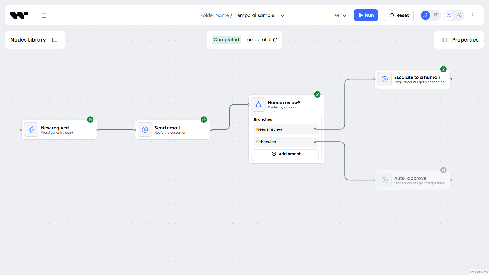
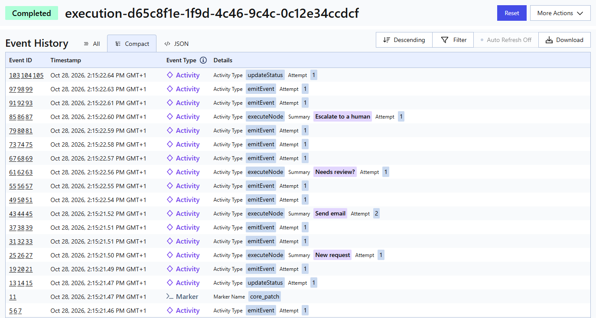

# Workflow Builder on Temporal

Run a workflow drawn in the Workflow Builder editor as a durable Temporal Workflow Execution: every node becomes an Activity, retries and history come from Temporal, and this sample's run plugin marks each node's status on the canvas (the Workflow Builder SDK ships no run status view; this is example code).

This sample wires the [`@workflowbuilder/temporal`](https://www.npmjs.com/package/@workflowbuilder/temporal) plugin into a Temporal Worker and executes a five-node diagram drawn in the [Workflow Builder](https://www.workflowbuilder.io) editor. You press **Run** on the canvas, and each node gets a status marker while Temporal runs it. One node fails on its first attempt on purpose, so the retry you see in Event History is a real one, and a decision node routes each run down one of two branches while the other is pruned.



## What runs where

```
editor (browser, npm run dev)  --POST canvas snapshot-->  bridge  -->  Temporal (temporal server start-dev)
        ^                                                    |  worker + bridge in one process (npm start)
        |                                                    |  executors: trigger, action, decision
        +----------- SSE: node events -----------------------+  store: prints events, streams them to the editor

npm run workflow  ---- reads shared/diagram.json, starts one run, waits for it ---->  Temporal
```

The editor posts the canvas to the bridge, the bridge starts a Workflow Execution on Temporal, the Worker runs it node by node, and the store streams every node event back to the editor. `npm run workflow` is the same run without a browser.

Three folders:

- `editor/` is the browser app: Workflow Builder with a **Run** button.
- `worker/` is the Node side: the Temporal Worker with the plugin, the bridge the editor talks to, and the CLI client.
- `shared/` is what the two sides agree on: the diagram (`diagram.json`), the wire types (`protocol.ts`) and the coin flip (`amount.ts`).

The diagram:

```
New request (trigger)
  -->  Send email (action, simulates an outage on its first attempt)
  -->  Needs review? (decision)
         |-- "Needs review"  {{nodes.trigger-1.amount}} isGreaterThan 100 -->  Escalate to a human (action)
         '-- "Otherwise"     no conditions ---------------------------------->  Auto-approve (action)
```

## Prerequisites

- Node.js 22 (20.3+ works).
- The Temporal CLI, from <https://docs.temporal.io/cli/setup-cli>:
  - macOS: `brew install temporal`.
  - Linux: `brew install temporal` if you have Homebrew, otherwise the Linux archive from that page.
  - Windows: the Windows archive from that page.

  With an archive, extract it and put the `temporal` binary (`temporal.exe` on Windows) on your `PATH`.

- Nothing else. No Docker, no database, no API keys.

## Run it

Fetch just this folder:

```bash
npx degit synergycodes/workflowbuilder/examples/workflow-builder-temporal workflow-builder-temporal
cd workflow-builder-temporal
```

Terminal 1, a local Temporal server:

```bash
temporal server start-dev
```

If something already holds 7233 or 8233 — another Temporal you started earlier — run this one
elsewhere:

```bash
temporal server start-dev --port 7234 --ui-port 8234
```

and set the addresses, which [`worker/src/config.ts`](worker/src/config.ts) reads, for both npm
commands in `worker/`: `npm start` below and `npm run workflow` in
[Without a browser](#without-a-browser). On macOS and Linux, put them in front of each command:

```bash
# terminal 2
TEMPORAL_ADDRESS=127.0.0.1:7234 TEMPORAL_UI_ORIGIN=http://localhost:8234 npm start

# without a browser
TEMPORAL_ADDRESS=127.0.0.1:7234 TEMPORAL_UI_ORIGIN=http://localhost:8234 npm run workflow
```

On Windows (PowerShell), set them in each terminal first; they last until you close it:

```powershell
# terminal 2
$env:TEMPORAL_ADDRESS='127.0.0.1:7234'; $env:TEMPORAL_UI_ORIGIN='http://localhost:8234'; npm start

# without a browser
$env:TEMPORAL_ADDRESS='127.0.0.1:7234'; $env:TEMPORAL_UI_ORIGIN='http://localhost:8234'; npm run workflow
```

Terminal 2, the Worker and the bridge, one process:

```bash
cd worker
npm install
npm start
```

Expected, between Temporal's own startup lines:

```
worker polling task queue "workflow-execution" on 127.0.0.1:7233
bridge listening on http://127.0.0.1:3210
```

Terminal 3, the editor. From the sample folder:

```bash
cd editor
npm install
npm run dev
```

Open the printed URL (Vite defaults to <http://localhost:5173>). The editor opens the diagram, named "Temporal sample". Click **Run**.

## What you see on the canvas and in Temporal UI

While the run is going, the button reads **Running…**. Each node shows a spinner while its Activity runs, then a check. `Send email` spins through both attempts, and the branch that was not taken turns grey.

Each run draws an amount between 1 and 200 and sends it as the trigger payload. The decision node routes on it, so about half the runs take each branch: run it a few times and the grey node swaps sides.

A small run panel appears below the app bar, in line with the Nodes Library and Properties bars. It shows the run's status (Starting, Running, Completed, Failed, Cancelled, Incomplete, or Error) and a **Temporal UI** link to the run, and it stays until the next run or a **Reset**. If something goes wrong, a snackbar shows the message and stays until you close it, start another run or press **Reset**: the bridge cannot be reached or rejects the request, the event stream is lost, or the run ends failed, cancelled or incomplete. When the run exists, the snackbar also has an **Open in Temporal UI** button. A completed run shows no snackbar.

Terminal 2 prints every event the store receives, the same lines shown in [Without a browser](#without-a-browser).

Open the **Temporal UI** link. The run is one Workflow Execution. Each node is an `executeNode` Activity with the node's label as its Summary. Click `Send email`: attempt 1 failed with `mail_server_busy`, attempt 2 succeeded. The retry is Temporal's, governed by the plugin's default node profile (10 minutes, 2 attempts), not by anything in this sample. The Workflow input carries the amount the run was given.

The pruned branch leaves no trace here: when the amount is above 100 there is an Activity for `Escalate to a human` and none at all for `Auto-approve`, because the workflow decided against that branch and never scheduled it.



## Change the diagram and run again

Edit a message, turn the outage switch on for another action, select **Needs review?** and edit its branches in the properties panel, or add a node from the Nodes Library. Then click **Run** again: the bridge runs whatever is on the canvas. Every diagram with one start node, no unconnected nodes and no loops runs on the plugin's one `runWorkflow`, so the Worker keeps running unchanged; only a new node type needs Worker code.

The editor keeps your canvas in the browser between visits. **Reset** asks first, then puts back the nodes and edges from [`shared/diagram.json`](shared/diagram.json), which is also the diagram `npm run workflow` submits. Use it too if a run fails with "The diagram has no start node": a canvas saved by an earlier version of this sample has a trigger without the start flag.

## Without a browser

`npm run workflow` submits [`shared/diagram.json`](shared/diagram.json) and waits for the run, which is handy for a quick check and shows the store's raw output. Keep terminals 1 and 2 running, and in another terminal, from `worker/`:

```bash
npm run workflow
```

Expected:

```
amount 130
started execution-878ca8cc-44f8-44a9-a1a9-bb80faa12c76
watch it: http://localhost:8233/namespaces/default/workflows/execution-878ca8cc-44f8-44a9-a1a9-bb80faa12c76
run completed
```

Expected in terminal 2, the store printing what the workflow emitted. Temporal's own `Activity failed`
warning for the first attempt appears between events #4 and #5, and the `decision-1` config line is long
because it carries the branches as authored:

```
[878ca8cc] # 1 execution_started {"workflowId":"workflow-builder-temporal-sample"}
[878ca8cc] status running
[878ca8cc] # 2 node_started (trigger-1) {"config":{"description":"Workflow entry point","status":"active"},"visibleNodeIds":[]}
[878ca8cc] # 3 node_completed (trigger-1) {"output":{"amount":130,"customer":"Ada"}}
[878ca8cc] # 4 node_started (action-1) {"config":{"description":"Notify the customer","status":"active","message":"Thanks for reaching out - we are on it!","simulateOutage":true},"visibleNodeIds":["trigger-1"]}
[878ca8cc] # 5 node_completed (action-1) {"output":{"delivered":true,"attempt":2,"message":"Thanks for reaching out - we are on it!"}}
[878ca8cc] # 6 node_started (decision-1) {"config":{"description":"Routes by amount","status":"active","decisionBranches":[...]},"visibleNodeIds":["trigger-1","action-1"]}
[878ca8cc] # 7 node_completed (decision-1) {"output":{"branch":"Needs review","sourceHandle":"source:inner:review"}}
[878ca8cc] # 8 node_skipped (action-3) {"reason":"branch_not_taken"}
[878ca8cc] # 9 node_started (action-2) {"config":{"description":"Large amounts get a second pair of eyes","status":"active","message":"Flagged for manual review","simulateOutage":false},"visibleNodeIds":["trigger-1","action-1","decision-1"]}
[878ca8cc] #10 node_completed (action-2) {"output":{"delivered":true,"attempt":1,"message":"Flagged for manual review"}}
[878ca8cc] #11 execution_completed
[878ca8cc] status completed
```

Only `Send email` carries `"attempt":2`: it is the one node with the outage switch on. Run it again
until the amount comes out at 100 or below, and events #7 to #10 take the other branch instead:

```
[734af0c9] # 7 node_completed (decision-1) {"output":{"branch":"Otherwise","sourceHandle":"source:inner:otherwise"}}
[734af0c9] # 8 node_skipped (action-2) {"reason":"branch_not_taken"}
[734af0c9] # 9 node_started (action-3) {"config":{"description":"Small amounts go straight through","status":"active","message":"Approved automatically","simulateOutage":false},"visibleNodeIds":["trigger-1","action-1","decision-1"]}
[734af0c9] #10 node_completed (action-3) {"output":{"delivered":true,"attempt":1,"message":"Approved automatically"}}
```

The `watch it:` link opens the same run in Temporal UI as the editor's **Temporal UI** link.

## How it works

Eight places carry the whole integration: six in the Worker, two in the editor. Each has a comment where the reason is not visible in the code.

1. [`worker/src/workflows.ts`](worker/src/workflows.ts) re-exports `runWorkflow`. Temporal bundles workflow code from one module, so a plugin cannot register its workflow for you; the re-export is how the bundle picks it up.
2. [`worker/src/worker.ts`](worker/src/worker.ts) creates `WorkflowBuilderPlugin({ executors, store })` and hands it to `Worker.create`. The plugin contributes the activities that execute each node, and `runWorkflow` from step 1 walks the graph. Connection, task queue, and shutdown stay yours.
3. [`worker/src/executors.ts`](worker/src/executors.ts) is one function per node type. Executors run inside the plugin's `executeNode` Activity, which is why `action` can read Temporal's attempt number and why throwing `TransientNodeExecutionError` gets it retried while `PermanentNodeExecutionError` does not.
4. [`worker/src/evaluate-branches.ts`](worker/src/evaluate-branches.ts) picks a branch, and the decision executor returns its handle as `nextPort`. That is what makes the graph branch: the runner fires only the edge whose handle matches, marks the rest `node_skipped`, and if a named port has no edge at all the run ends `incomplete` rather than failing. The first branch whose conditions hold wins. A branch with no conditions is the fallback wherever it sits, because the editor adds new branches after it and cannot reorder them.
5. [`worker/src/store.ts`](worker/src/store.ts) implements the store port: where events and status changes land. Here they go to the terminal and to the editor's event stream. In your application they go to a database; the port is the same. The first terminal status a run reaches is final: a late `running` or `waiting`, or a second terminal status, can still arrive and is dropped.
6. [`worker/src/to-definition.ts`](worker/src/to-definition.ts) turns the editor's snapshot into the plugin's `WorkflowDefinition`. A node is the run's start when its data carries `isStartNode: true`, which the editor copies from the palette item on drop. The plugin knows nothing about React Flow; this file is the only place that translates between the two formats.
7. [`editor/src/nodes/`](editor/src/nodes/) holds the palette items. A palette item's `type` is the key of its executor in `worker/src/executors.ts`. The trigger sets `isStartNode: true` and declares an `outputSchema`, so a decision node's condition editor offers `amount` and `customer` in its variable picker. The decision node is built on the SDK's decision template, which gives it the branches you edit on the node and in the properties panel.
8. [`editor/src/execution/`](editor/src/execution/) is the run plugin. It puts the **Run** button in the SDK's `OptionalAppBarControls` slot, the run panel in `OptionalAppChildren` and the node markers in `OptionalNodeContent`, and raises an error snackbar with `showSnackbar()` when a run fails. On **Run** it takes the canvas with `getStoreDataForIntegration()`, posts it to the bridge with the run's trigger payload, and follows the run's events over Server-Sent Events.

[`editor/src/app.tsx`](editor/src/app.tsx) mounts the editor with these plugins and an `isValidConnection` that refuses any edge into the start node.

[`worker/src/client.ts`](worker/src/client.ts) starts a run through `TemporalWorkflowEngine` from `@workflowbuilder/temporal/client` and then waits on an ordinary Temporal workflow handle. [`worker/src/bridge.ts`](worker/src/bridge.ts) does the same for the editor over HTTP and streams the store's events back as Server-Sent Events.

## Make it yours

- **Add a node type.** Add a palette item under `editor/src/nodes/` and register it in `editor/src/nodes/index.ts` (set `isStartNode: true` on it if runs should start there); add a variant to `SampleNode` in `worker/src/nodes.ts` and an executor in `worker/src/executors.ts`. TypeScript refuses to compile until the executor exists.
- **Tune retries per node type.** Replace the re-export in `worker/src/workflows.ts` with `createRunWorkflow({ nodeActivityProfiles })` and pass the same map to the plugin. The plugin README explains why both sides need it.
- **Point at Temporal Cloud.** `TEMPORAL_ADDRESS`, `TEMPORAL_NAMESPACE`, and `TEMPORAL_UI_ORIGIN` are read in `worker/src/config.ts`. TLS and API keys go on the three connections: the worker and the bridge in `worker/src/worker.ts`, the CLI in `worker/src/client.ts`. To move the bridge off port 3210, set the same `BRIDGE_PORT` for `npm start` and `npm run dev`.
- **Toggle the outage.** Every Action has a _Simulate an outage on the first attempt_ switch. Turn it on for `Auto-approve` and that node retries too.
- **Add a branch.** Select **Needs review?**, add a branch on the node or in the properties panel, give it a title and conditions, then drag its new handle to a node. Conditions read only `{{trigger.*}}` and `{{nodes.*}}`; the worker does not resolve `{{global.*}}` variables.
- **Persist events.** Replace `createRunStore()` with anything that implements `ExecutionStore`. In a database, make `(executionId, sequence)` unique, so an event written twice by a retried Activity is rejected. Keep its rule that the first terminal status wins: a status that arrives after it must not replace it. Keep the `outcome` that arrives with `completed` as well: it is the run's result.

## Learn more

- [`@workflowbuilder/temporal` on npm](https://www.npmjs.com/package/@workflowbuilder/temporal): profiles, node labels in Event History, versioning and replay.
- [Workflow Builder documentation](https://www.workflowbuilder.io/docs/overview/)
- [Run on Temporal guide](https://www.workflowbuilder.io/docs/guides/use-with-temporal/)
- [Temporal TypeScript SDK](https://docs.temporal.io/develop/typescript)

## License

Apache-2.0. See [LICENSE](LICENSE).
